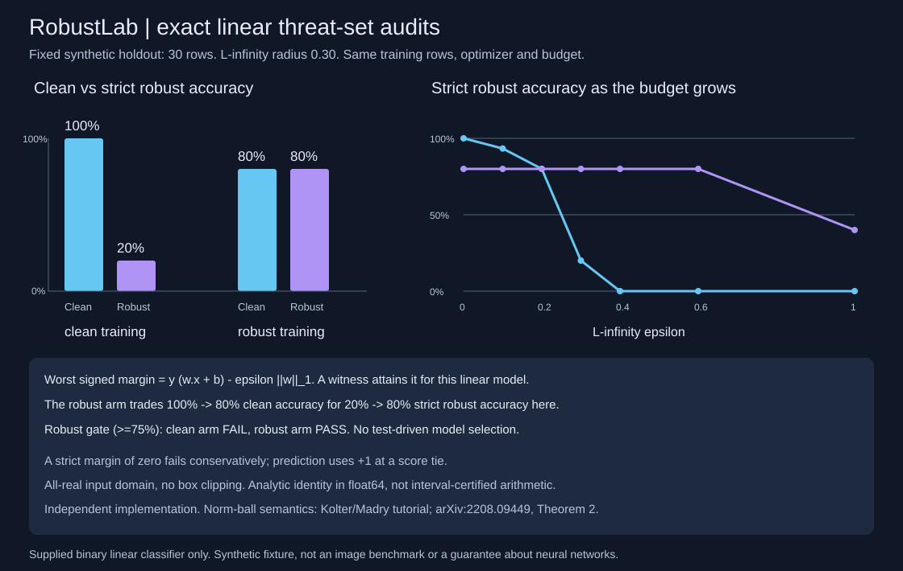
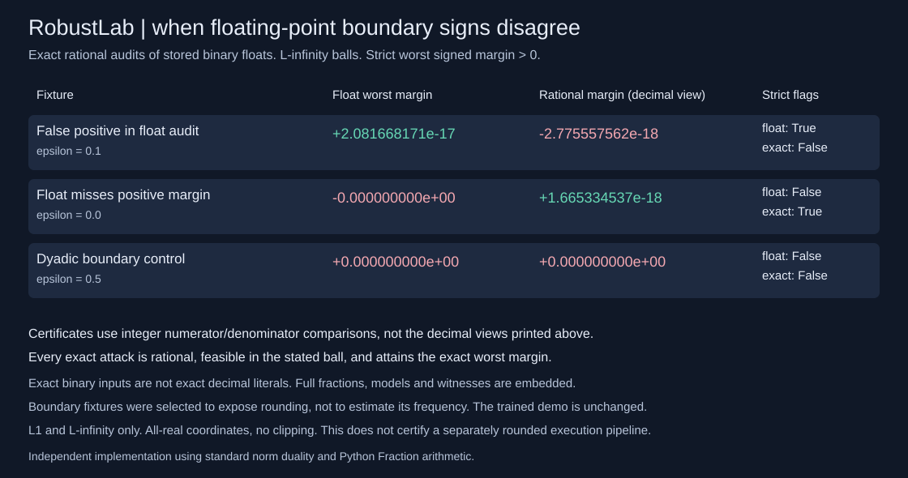
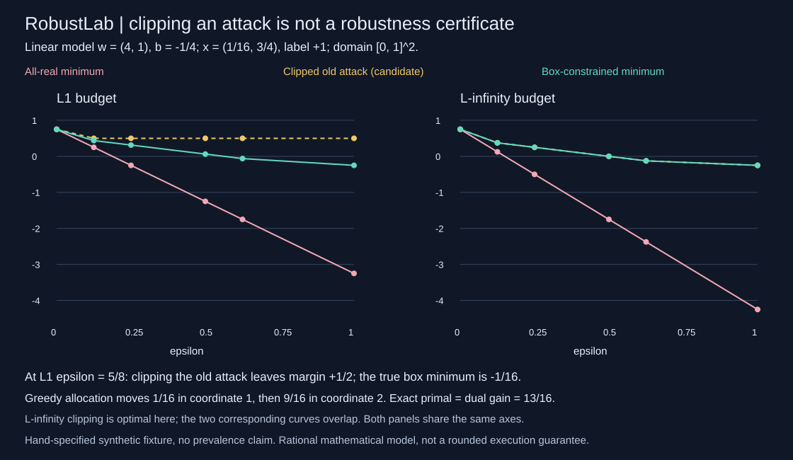

# RobustLab

A dependency-free adversarial robustness lab for **binary linear classifiers**. Exact norm-ball worst-case margins, attainable perturbation witnesses, hand-derived robust logistic subgradients, and a deliberately visible clean/robust trade-off.

The point is to make the threat set and the limits inspectable. An analytic certificate for a linear score is not a certificate for a neural network, an image preprocessing pipeline, or an unspecified real-world attack.



## A gate that fails in one direction and passes in the other

Run from the repository root with Python 3.10+:

```sh
python -m robustlab demo
python -m unittest discover -s tests -v
PYTHONPATH=. python examples/render_audit.py --check
```

Two full-batch models train on the same fixed 30 synthetic rows, from zero, for 4,000 steps at learning rate 0.1 with L2 coefficient 0.001. The only changed training setting is the L-infinity perturbation radius: 0 versus 0.30. There is no validation selection, best-seed reporting or test-driven stopping. Reported results use a distinct deterministic 30-row shifted factorial holdout, not independent random samples.

| Training objective | Holdout clean accuracy | Strict robust accuracy at L-infinity radius 0.30 | Robust gate >=75% |
|---|---:|---:|---|
| Ordinary logistic, radius 0 | 100% | 20% | Fail |
| Robust logistic, radius 0.30 | 80% | 80% | Pass |

This fixture was specified directly: balanced labels, a strong coordinate with one of five signs reversed, and a perfectly aligned but small-magnitude coordinate. The ordinary model can use the weak coordinate to resolve the strong coordinate's exceptions. A radius-0.30 adversary can overwhelm that weak coordinate. The robust objective instead mostly uses the strong coordinate, accepting the exceptions. This illustrates a trade-off on this constructed fixture, not a general theorem that robust training must reduce clean accuracy.

The demo returns both models, training settings and sampled loss histories, all train and holdout row-level attacks, holdout radius sweeps, all input rows and gate booleans. Sweep summaries omit duplicated row records; use `audit` at any radius to recover them. Both arms remain visible regardless of gate outcomes. Robust training is fixed-step subgradient descent, not a claim of convergence to a global minimizer.

## What is exact

For score `s(x) = w.x + b`, label `y` in `{-1,+1}`, and a perturbation satisfying `||delta||_p <= epsilon`, the minimum signed margin is:

```text
m_worst = y (w.x + b) - epsilon ||w||_q
1/p + 1/q = 1
```

| Input perturbation ball | Dual weight norm | A returned worst-case perturbation |
|---|---|---|
| L1 | max absolute weight | Put the full budget on the first maximum-absolute-weight coordinate, opposite `y*w` |
| L2 | Euclidean weight norm | `-epsilon*y*w / EuclideanNorm(w)` |
| L-infinity | sum of absolute weights | `-epsilon*y*sign(w)` |

Zero weights get a zero perturbation. At L1 ties, the first maximizing coordinate is chosen deterministically. These witnesses attain the lower margin in real arithmetic. The input domain is **all real coordinates**, without feature boxes or clipping. Bias is not perturbed. The implementation evaluates the identity in floating point; it is not an outward-rounded or interval-arithmetic proof. Near-boundary rounding must not be used as a safety guarantee.

`strict_robust_correct` means the worst signed margin is **strictly positive**. Equality fails conservatively for either label. Prediction itself uses `+1` at a score of zero, so ordinary accuracy and strict margin accuracy can differ at ties. A false strict flag is not automatically a misclassification witness: the attained margin can be exactly zero, where the prediction tie rule matters.

`radius_to_zero_margin` is `max(0, y*s/||w||_q)` for nonzero weights. A clean error has radius zero. With zero weights it is `null` because no perturbation changes the score; `radius_unbounded` distinguishes a strictly correct constant classifier from an incorrect or boundary one. Radius values specify the zero-margin boundary, not an assertion of correctness at that boundary.

## API and strict JSON CLI

```python
from robustlab import audit, fit, objective_gradient

model = {"version": 1, "weights": [3.0, 4.0], "bias": 0.1}
data = {"x": [[0.7, -0.2], [-0.4, 0.3]], "y": [1, -1]}
report = audit(model, data, norm="l2", epsilon=0.4)
trained = fit(data, norm="linf", epsilon=0.3, steps=1000, rate=0.1, l2=0.001)
gradient = objective_gradient(model, data, norm="linf", epsilon=0.3, l2=0.001)
```

```sh
python -m robustlab audit examples/model.json examples/data.json --norm l2 --epsilon 0.4
python -m robustlab fit examples/data.json --norm linf --epsilon 0.3 --steps 1000
```

`audit` returns the normalized model and threat specification, dual norm, per-row scores/predictions/clean and worst margins, flags, radii, perturbations, attacked coordinates and actually attained signed margins. `fit` returns a model inside its result; extract the `model` object to pass to `audit`. It never silently treats the whole training result as a model.

The model requires exactly `version`, `weights`, `bias`; version is integer 1. Data requires exactly `x`, `y`; labels are integer -1 or +1, not booleans or floats. Up to 128 dimensions and 4,096 rows; input numbers are finite with magnitude at most 1,000,000; epsilon and L2 coefficient are nonnegative within that same bound. No implicit rescaling or feature normalization is performed. A radius is measured in the provided coordinate system, so different feature units change its meaning.

Training allows 1..20,000 steps, learning rate in `(0,10]`, and preflights a 20-million row-coordinate-step work cap before evaluating its objective. History includes step zero, checkpoints every `max(1, steps//100)` updates, and the final objective. These are checkpoints, not every update for long runs. Parameter updates outside finite magnitude bounds stop with an error, not a partially returned model.

JSON files are capped at 1 MiB and reject duplicate keys, nonfinite constants, unknown fields and dimensional inconsistencies. CLI errors exit 2 with no partial JSON or traceback. APIs return fresh records and do not mutate the inputs or the global random state. Runtime and tests use only Python's standard library.

## Objective and gradient audits

The loss is the mean of `softplus(-y*s + epsilon*dual_norm(w))` plus `l2/2 * sum(w_j**2)`. The robustness term is **inside** the softplus, not an ordinary norm regularizer pasted outside it. Stable softplus and sigmoid calculations avoid exponent overflow on extreme scores. L2 regularization excludes the bias.

The selected norm subgradient is `sign(w)` for L-infinity input balls, normalized `w` for L2, and one signed maximum coordinate for L1. At zero or tied weights, these are valid subgradients, not claims of differentiability. Fixed learning rates can oscillate near a kink. The robust demo's small near-zero second weight remains reported rather than clipped away or presented as exact sparsity.

80 tests cover the original float/training checks and exact-rational checks below. The original checks include:

- All L-infinity corners for 240 small model/label configurations, using independent rational arithmetic; separate L1-vertex references and an L2 Cauchy/10,000-direction circle check.
- Hand-derived gradients against central finite differences for all three norms away from kinks, plus convex subgradient inequalities at zero/tied weights and a corner-enumerated robust-loss reference.
- Label/bias signs, zero weights, strict boundary ties, positive-scaling-invariant radii, monotone radius sweeps, threat-set distinctions and no-clipping witnesses.
- Extreme scores, exact first optimizer update/final objective, deterministic training, work-cap preflight, explosive-update rejection, invalid schemas, dimension/row boundaries, input/RNG isolation and CLI failure behavior.
- Both demo gate directions and every holdout witness. Four figure tests check all four bar coordinates, all 14 sweep points, full unchanged metadata, byte regeneration, input preservation and rejection of altered fits/attacks/fixtures.

The references verify finite test families; they are not a machine-checked proof for arbitrary floating-point inputs. The SVG is generated from the complete unchanged demo, with the full fixture, models, settings, histories and audits embedded as metadata.

## Exact rational boundary audits

The float caveat can change a strict flag, not only its displayed last digit. `exact_audit` provides an independent arithmetic mode for **L1 and L-infinity only**:

```python
from robustlab import exact_audit

model = {"version": 1, "weights": [0.1, 0.2], "bias": -0.30000000000000004}
data = {"x": [[1.1, 1.1]], "y": [1]}
proof = exact_audit(model, data, norm="linf", epsilon=0.1)
```

```sh
python -m robustlab exact-demo
python -m robustlab exact-audit examples/model.json examples/data.json --norm linf --epsilon 0.1
PYTHONPATH=. python examples/render_exact.py --check
```



For the stored binary numbers above, the float worst margin is about `+2.081668171e-17`, while the exact rational worst margin is negative, about `-2.775557562e-18`. Thus the ordinary float strict flag is true and the exact flag is false. The exact-demo also includes a cancellation case where float arithmetic misses a strictly positive margin and a dyadic exact-zero control.

The first boundary fixture was found by a finite numeric edge-case search, not by random sampling: enumerate weights and coordinates from `[.1,.2,.3,.4,.7,1.1]` in two dimensions, epsilon from that same ordered list, set float bias to `epsilon*sum(weights)-sum(w_j*x_j)`, inspect labels -1 then +1, and retain the first float-positive/exact-nonpositive case. The cancellation case and dyadic control were directly constructed. These are selected numeric boundary examples, **not an estimate of disagreement frequency**. The original training fixture, results and SVG are unchanged.

Every accepted number is converted to the exact rational value of the **validated binary float stored by Python**, following [`Fraction.from_float`](https://docs.python.org/3/library/fractions.html). This does not turn the decimal text `0.1` into the rational `1/10`. The model, input rows, epsilon, score, dual norm, clean/worst/attained margins, radius, delta and attacked coordinates are serialized as reduced numerator/positive-denominator **strings**. Signs and flags use integer comparisons, never a decimal rendering. Counts remain integers; the report includes the corresponding float margin/flags/prediction and disagreement counts. Rational witness feasibility and equality to the worst margin can be checked without rounding it back to float.

The API reuses the original schema/size/numeric checks and adds a preflight cap of 4,096 row-coordinate products before any fraction work. L2 is rejected explicitly: its general worst margin and attaining direction can be irrational. The CLI shares the strict duplicate-key/file-size/error handling. Neither the inputs nor the original float audit are changed.

An exact rational margin certifies the mathematical linear function with these exact stored coefficients over the stated real-valued threat ball. It does **not** certify the execution of an independent floating-point inference pipeline, its rounded attacks, preprocessing or hardware. The exact attack is rational, so rounding its coordinates can change a near-boundary result. All-real domain and strict-zero conventions still apply.

Seventeen arithmetic/API/CLI tests add independent rational corner/vertex minima across 156 model/label/norm configurations, exact feasibility and attained-score reconstruction, both disagreement directions, binary-versus-decimal semantics, prediction disagreements, zero/tied weights, an actually executed 4,096-product boundary, preflight ordering and the smallest positive subnormal squared. Four more figure tests check all six displayed flags, numeric signs, coordinates, full metadata, regeneration and rejection of changed inputs. That increment brought the suite to 56 tests and two reproducible SVGs; the box increment below brings it to 80 tests and three SVGs.

## Exact box-constrained attacks: clipping is not the L1 solution

`box_audit` solves a different, explicit threat set: the L1 or L-infinity ball intersected with supplied per-coordinate closed bounds. Every clean input must already lie inside the box. The original all-real audits and trained demo are unchanged.

```python
from robustlab import box_audit
result = box_audit(
    {'version': 1, 'weights': [4, 1], 'bias': -.25},
    {'x': [[.0625, .75]], 'y': [1]},
    {'lower': [0, 0], 'upper': [1, 1]},
    norm='l1', epsilon=.625)
```



The hand-specified dyadic example has clean margin `3/4`. At L1 radius `5/8`, the old all-real attack spends its budget on coordinate 1. Clipping that attacked point back into the box leaves margin `+1/2`, which is only a feasible candidate's margin. The actual box-constrained minimum is `-1/16`: move `-1/16` in coordinate 1 and `-9/16` in coordinate 2. Declaring robustness from the positive clipped candidate would be wrong. Under L-infinity, independently clipping the adverse coordinate moves is optimal; those two curves overlap in the figure.

For L1, the solver allocates movement to descending absolute weights, up to each coordinate's adverse-direction capacity. Equal weights use ascending coordinate index. It returns exact rational movement, attacked coordinates, norm, clean/worst/attained margins and a matching dual gain bound. For gains `g_i = abs(w_i)`, capacities `c_i`, movement `t_i`, nonnegative multipliers `lambda, mu_i` with `g_i <= lambda + mu_i` certify:

```text
sum(g_i*t_i) <= lambda*epsilon + sum(c_i*mu_i)
```

The returned primal gain equals that upper bound, with zero rational gap. Combined with the feasible attaining attack, this certifies the mathematical minimum, without trusting the greedy routine alone. For L-infinity, effective capacities are `min(c_i, epsilon)` and the independent-coordinate dual uses `lambda = 0`. Bias is fixed. Zero weights move nowhere; degenerate boxes and unused L1 budget are supported. Bounds, model values, inputs and epsilon mean their exact validated binary floats, as in `exact_audit`, not decimal fractions or a separately rounded inference pipeline.

```sh
python -m robustlab box-demo
python -m robustlab box-audit examples/model.json examples/data.json examples/bounds.json --norm l1 --epsilon 0.3
PYTHONPATH=. python examples/render_box.py --check
```

The box JSON requires exactly `lower` and `upper` vectors matching the model dimension; each finite coordinate has magnitude at most 1,000,000. Lower bounds may equal upper bounds but never exceed them; out-of-box clean rows are errors, not silently clipped. The same 128-coordinate/4,096-row validators and strict 1 MiB CLI file rules apply, with a separate 4,096 row-coordinate-product cap checked before rational conversion. L2 is explicitly rejected. No box-constrained training is implemented.

Twenty new arithmetic/API/CLI tests include an independent full orthant-polytope vertex oracle on 468 configurations, exact feasibility and primal/dual reconstruction, both labels/asymmetric bounds, saturated and degenerate boxes, zero/tied weights, monotonicity, nonbinding-box agreement with `exact_audit`, the clipping counterexample, subnormal arithmetic, isolation, actual cap execution and preflight/CLI rejection checks. Four new figure tests verify all 36 plotted coordinates, six polylines, shared domains, complete unchanged metadata and exact regeneration. Total: 80 tests and three reproducible SVGs. The fixture was directly specified, with no parameter search or prevalence claim.

The bounded fractional-knapsack formulation is standard; see [Duke CS330 lecture 15, section 5.1](https://courses.cs.duke.edu/spring20/compsci330/lecture15scribe.pdf). The reduction to signed linear attacks, code, certificate records, exhaustive test oracle and figures here are independent implementations.

## Sources and limits

This is an independent implementation of standard norm duality and robust linear logistic training, following the linear-case discussion in [Kolter and Madry's Adversarial Robustness tutorial](https://adversarial-ml-tutorial.org/adversarial_ml_slides_parts_2_3.pdf) and the logistic inner problem in [On Exact Solutions of the Inner Optimization Problem of Adversarial Robustness, Theorem 2](https://arxiv.org/html/2208.09449v3). Code, fixture, tests and figure are original to this repository; no external dataset or implementation is bundled.

No nonlinear verification, multiclass classifier, perceptual metric, adaptive attack suite, distributional guarantee, calibrated uncertainty or production security claim. No paid service, model download, API key, GPU or network access is needed. MIT licensed.
